# 异形智裁项目计划书

> 编制日期：2026 年 11 月 21 日  
> 文档版本：v1.4  
> 对照基线：当前工作区源码 1.0.3（含未提交的界面与文档调整）  
> 范围：圆桌／弧形台、正圆／同心圆、马肚形及其共用能力  
> 依据：当前工作区源码、README、用户使用说明、CHANGELOG、架构说明和性能记录；本计划不是已完成验收的声明。

### 文档修订记录

| 版本 | 日期 | 修订内容 |
|---|---|---|
| v1.0 | 2026-11-21 | 初稿：整理三类轮廓现状、业务流程、模块设计、验收与风险 |
| v1.1 | 2026-11-21 | 增加当前程序界面截图；补充项目组织、发布与版本管理、已知问题、非功能与兼容性、合规授权、运营支持、交付物同步和需求追踪 |
| v1.2 | 2026-11-21 | 新增“项目背景”章节，补充业务场景、现有痛点、项目价值、目标用户与典型流程，并加入草图核对和手工排版截图 |
| v1.3 | 2026-11-21 | 按客户草图校正弧形台示例：最大宽度 138 cm、总高 86 cm、直边 108 cm；新增草图示例图，更新草图核对与手工排版截图及说明 |
| v1.4 | 2026-11-21 | 封面标题、章节标题、图表文字和正文统一改为黑色 |

## 一、项目背景

### 业务场景

异形智裁面向定制台面、圆桌、弧形台、餐桌垫和展示台面的图案制作。客户通常以“花型 + 形状 + 尺寸”的形式下单，例如 `花幔;80X140cm`、`蔓生花;95CM圆形`。设计人员需要从素材库中找到对应花型的矩形素材，再按客户要求的轮廓重新组织边框、花边和中央图案。

这类订单的特点是：花型多、尺寸变化频繁、单批数量不大但交期紧；同一款花型可能同时用于圆桌、弧形台、正圆和同心圆；图案的边框、文字、圆点和层次往往不能被简单裁掉。输出既要能快速预览给客户确认，也要能按 DPI 生成可用于后续制作的文件。

### 现有工作方式与痛点

传统做法通常是在图像处理或排版软件中手工完成：先凭经验从图库找素材，再画轮廓、裁切、拉伸、拼接边框，最后核对尺寸并导出。面对重复订单，设计人员往往要反复调整同一类参数。

| 痛点 | 具体表现 | 影响 |
|---|---|---|
| 查图依赖经验 | 订单名、花型别名和素材文件名不完全一致，需要逐张翻看图库 | 找图慢，容易选错材质或近似花型 |
| 尺寸容易传错 | 订单尺寸、草图标注、补偿后尺寸和实际输出尺寸混用 | 成品偏大偏小，返工重做 |
| 直接裁切损伤设计 | 矩形素材的边框、文字、圆点和层次被截断或压扁 | 花纹不完整，客户不认可 |
| 重复劳动多 | 同类订单需要重复画轮廓、拼边框、改参数 | 出图效率低，难以应对集中交期 |
| 结果依赖个人 | 不同人员对边框、间隙和补偿的理解不同 | 同一订单效果不稳定，交接困难 |
| 缺少核对记录 | 草图、订单名和最终参数之间没有统一留痕 | 出错后难以追溯，培训成本高 |

这些问题的共同点是：大量时间花在重复操作和核对上，而不是设计判断；一旦尺寸或补偿理解错误，返工成本很高。

### 项目目标与价值

本项目把订单解析、素材匹配、轮廓计算、边框映射、预览和导出固化为一条可重复的流程，并把不确定的地方显式交给人工确认：

- **输入统一**：订单名称、尺寸、草图和图库集中在同一工作台；
- **匹配可解释**：显示匹配尺寸、比例差、素材路径和识别提示，而不是只给一个结果；
- **轮廓参数化**：圆桌、弧形台、正圆／同心圆和马肚形分别使用明确的尺寸语义；
- **保留原设计**：尽量沿用素材原有边框、花纹和层次，减少直接裁切造成的损伤；
- **预览与输出一致**：预览和成品使用同一组参数，输出带 DPI 信息；
- **人工可兜底**：草图识别失败、素材不合适或轮廓特殊时，允许手工填写尺寸和进入手工排版工具。

项目价值主要体现在减少重复操作、缩短打样和出图时间、降低尺寸与边框错误、让经验不足的人员也能按流程完成，以及把自动识别的不确定性暴露出来，避免静默出错。

### 目标用户与典型流程

主要用户是处理定制订单、制作台面效果图、准备打印或生产文件的人员，以及需要核对成品的设计和业务人员。

典型流程如下：

1. 输入订单名称和尺寸，或上传客户草图；
2. 程序解析花型、材质和尺寸，在图库中匹配候选素材；
3. 使用草图 OCR 或手工填写核对尺寸，确认轮廓模块；
4. 生成预览，检查边框、文字、方向和接缝；
5. 必要时打开手工排版工具调整外轮廓、花边、选区和内圆；
6. 按约定 DPI 导出 JPG 或 PNG，并保留订单参数和素材记录。

客户草图通常只标注轮廓和几个关键尺寸。下例是弧形台草图，标注最大宽度 138 cm、总高 86 cm、直边 108 cm，底部提示需要提供桌子的 A／B／C 尺寸；字母对应的具体边仍需业务人员对照实物确认。草图用于辅助读取尺寸，示例尺寸会被程序按同样方式录入并显示识别结果，但仍需人工对照轮廓和订单信息后勾选确认。宽高各补偿 1 cm，直边不补偿；识别偏差不会被静默当作最终尺寸。

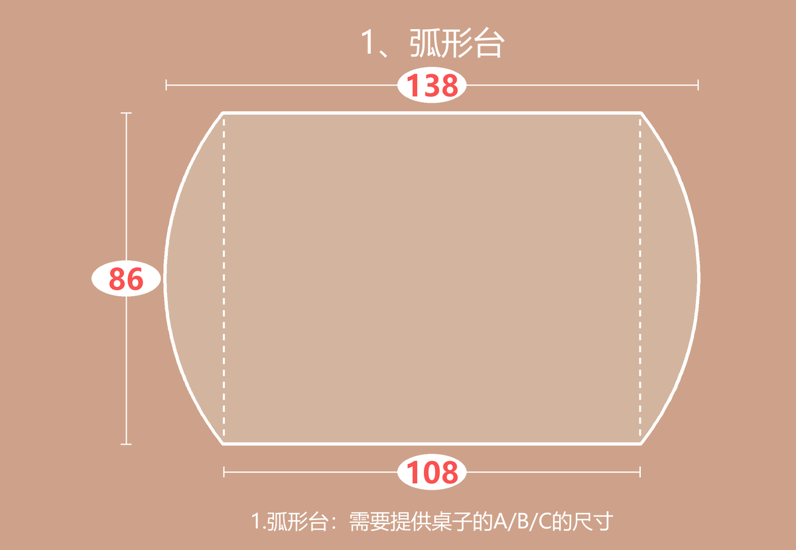

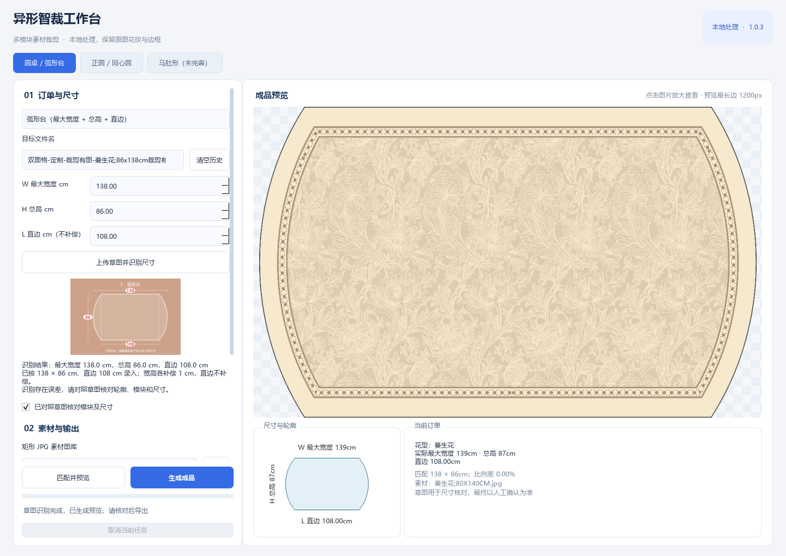

手工排版工具用于自动流程无法可靠处理的情况：可以调整外轮廓、外边框、素材选区、花纹填充、中心圆和导出 DPI，并保存或打开设计文件。它是自动流程的兜底，不是另一套独立业务。

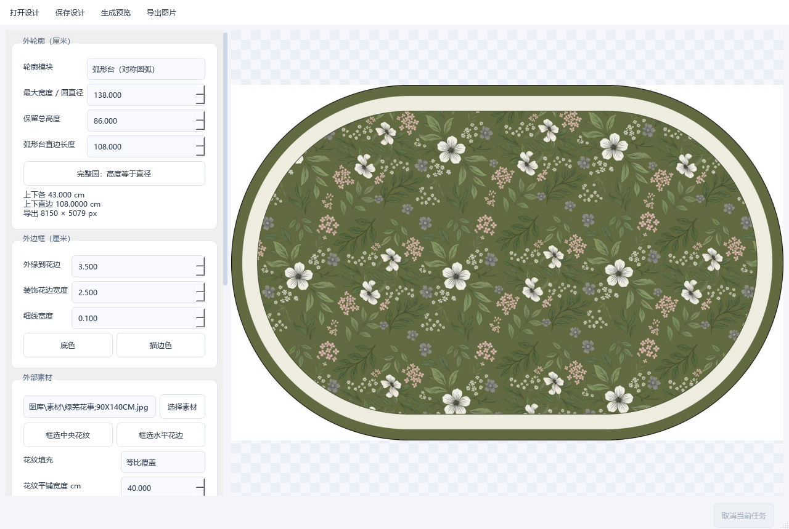

### 项目缘起与当前阶段

项目从圆桌和弧形台素材适配开始，逐步扩展到正圆／同心圆和马肚形，并增加了草图识别、图库匹配、后台渲染和手工排版能力。由于功能是在真实订单中逐步补充的，当前源码、README、用户手册和分发包之间存在状态差异。

本计划书的作用，是把“已经有什么、还缺什么、如何验收、如何发布”放在同一份基线中，避免把已有入口误认为已验收功能，也避免把历史截图和旧版本文档当作当前能力说明。

## 二、项目概述

异形智裁是一款面向异形台面素材设计的 Windows 本地桌面工具。它以订单名称、实际尺寸、草图和素材图库为输入，生成符合指定轮廓的图案成品。项目的核心不是只把图片裁成形状，而是在尺寸约束下尽量保留素材原有花纹、边框与层次，供用户核对并输出 JPG 或 PNG。

典型使用者是处理定制订单、制作台面效果图或准备打印文件的人员。一个典型订单是输入 `花幔;80X140cm`，程序解析名称和尺寸、查找对应矩形素材、按目标轮廓排版，再由操作人员核对预览并导出。这个例子来自项目 README，具体业务效果仍须以实际素材和订单验收。

### 项目要解决的问题

1. **查图耗时且易选错**：订单名称和素材名称散落在图库中，需要按花型、材质和尺寸匹配。
2. **尺寸容易传错**：订单文件名、手绘草图和成品尺寸之间可能不一致；补偿规则也容易重复计算。
3. **矩形素材直接裁切会损伤设计**：边框、装饰、文字和中央图案可能被截断、扭曲或错位。
4. **多种形状需要不同几何规则**：圆桌、弧形台、同心圆和马肚形的尺寸表达及边界关系不同，不能用同一张遮罩草率处理。
5. **预览与输出要求不同**：操作时需要及时反馈，最终输出又需要合适的像素、DPI、透明度和打印尺寸。
6. **自动识别存在不确定性**：素材结构复杂，草图 OCR 也可能出错，必须保留人工核对和纠错途径。

### 项目边界

本阶段聚焦上述三类形状及共用的素材匹配、识别、预览和导出能力。不以任意轮廓自动拟合、PSD、色彩配置转换、云端协作为当前承诺；这些内容如有业务需求，再单独立项。软件提供成品图，物理加工效果、打印机色彩和包边工艺仍需实际生产验证。

## 三、当前状态与规划区分

| 模块 | 从当前源码可确认的状态 | 本计划需要完成或验证的内容 |
|---|---|---|
| 圆桌／弧形台 | 已有界面、尺寸处理、轮廓计算、素材匹配、预览和导出；支持本地草图 OCR | 持续以真实订单验收尺寸、接缝、复杂边框和异常提示 |
| 正圆／同心圆 | 当前源码已有独立界面、匹配和生成流程；支持内外素材、间隙、预览和导出 | 核实业务对间隙、补偿、描边、透明区域及不同素材的要求，完成端到端验收 |
| 马肚形 | 有独立入口，界面标记“未完善”；已有对称轮廓、渲染及手动尺寸输入；草图仅供对照 | 确认曲线和尺寸定义，验证真实样板、边框映射与输出后再确定可用于生产的范围 |
| 共用能力 | 文件名解析、图库索引、素材分析、后台处理、JPG／PNG 输出等已有实现 | 完善跨模块一致性、错误解释、回归样本及操作说明 |

仓库 README 和用户手册仍把正圆／同心圆和马肚形描述为待开发，已落后于当前源码。本计划采用源码现状；上述状态不代表运行测试或生产验收已经通过。

### 3.1 当前程序界面

以下截图由当前源码在离屏环境渲染生成，用于说明界面结构。截图中的订单名称、素材名称、匹配提示和成品预览为界面示意，不代表已经完成生产验收的订单。

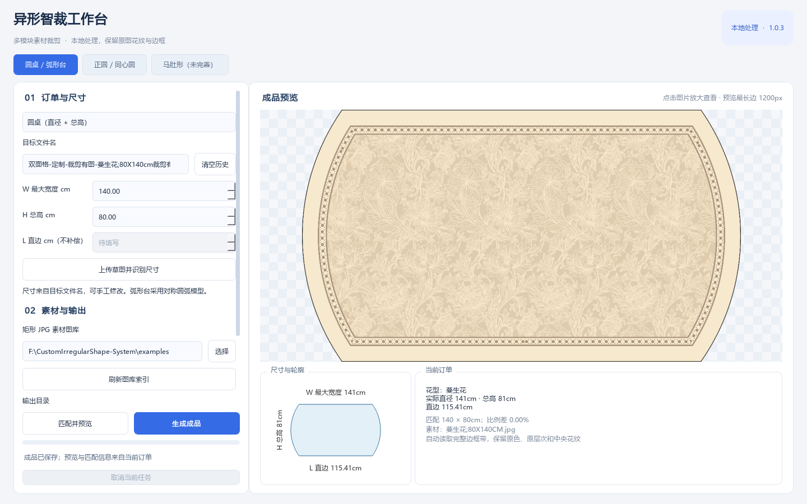

界面左侧用于输入订单、选择图库、设置尺寸补偿和直边；中间显示匹配素材与自动识别提示；右侧同时提供成品预览和轮廓尺寸示意。

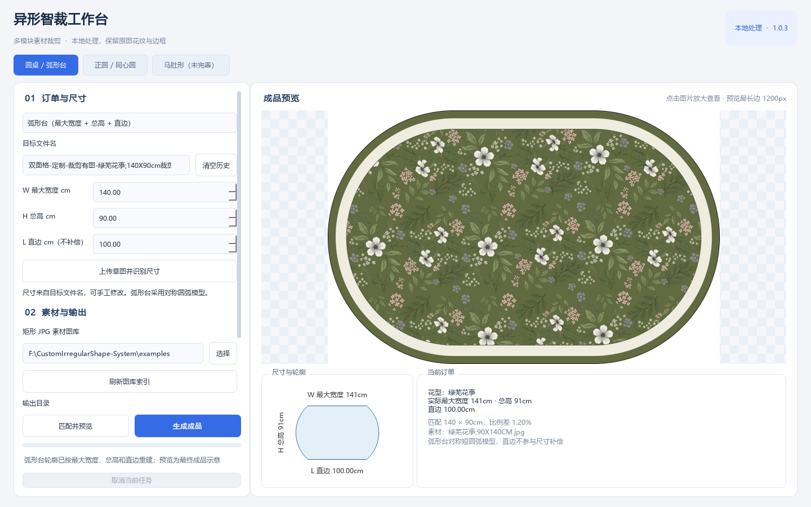

弧形台在圆桌参数基础上增加“直边长度”。直边只影响轮廓形状，不参与总尺寸补偿；预览与轮廓示意使用同一组尺寸和补偿参数。

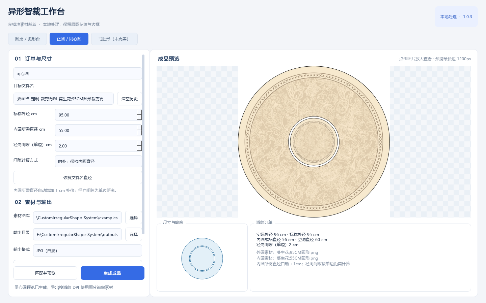

正圆／同心圆拥有独立入口，可选择正圆或同心模式，设置外径、内圆所需直径、单边径向间隙、间隙方向和直径损耗补偿，并可分别指定外圆、内圆素材。截图中的成品预览来自 `实际输出示例`，仅作界面示意。

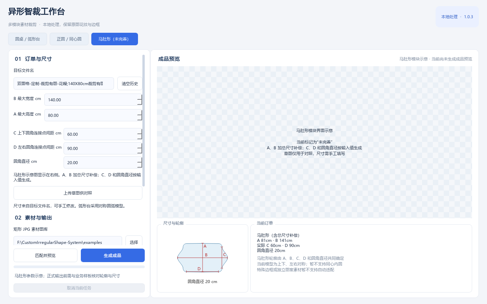

马肚形当前标记为“未完善”，需要手工填写 A、B、C、D 和圆角直径；草图只用于对照，不自动关联尺寸。该模块在真实样板验证前不进入生产承诺范围。

## 四、业务流程与系统功能

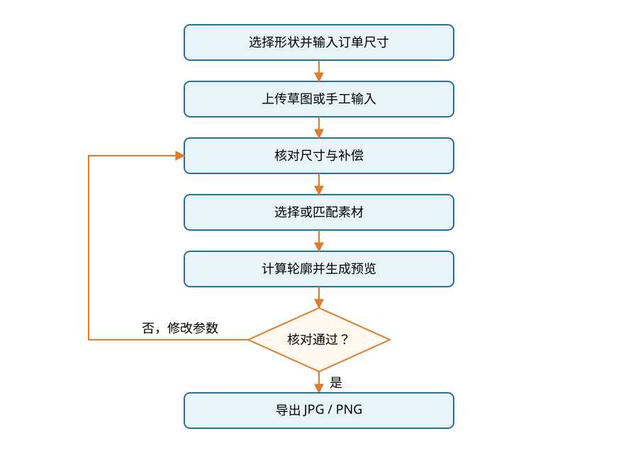

共用功能包括：订单信息解析；图库搜索和指定素材；尺寸补偿及有效性校验；轮廓示意和成品预览；素材结构分析；后台渲染、进度提示和异常处理；图片输出。圆桌／弧形台草图使用 Windows 本地 OCR，结果需人工核对；马肚形当前需人工填写草图尺寸。手工排版支持 JSON 保存与读取，但不应据此假定所有独立模块均支持项目保存。

## 五、形状模块设计

### 5.1 圆桌／弧形台

**解决的问题：**将现有矩形产品素材适配到截圆台面或两侧对称弧形台面，同时让尺寸和原有边框更容易核对，减少手工画轮廓、选素材和重复调整的工作。

**轮廓示意（非比例图）：**

**圆桌（截圆）**

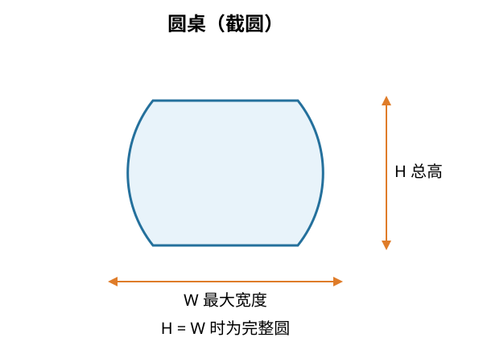

**弧形台**

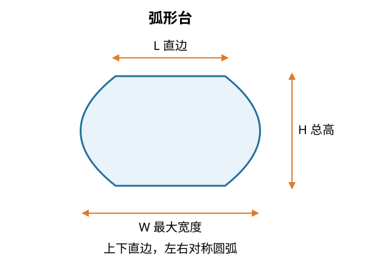

**接近椭圆的弧形台示例：**调整上下直边长度后，弧形台可以呈现接近椭圆的视觉效果。下图依据提供的界面截图：输入总高 90 cm、直边 60 cm，界面显示补偿后的实际最大宽度 141 cm、总高 91 cm，直边保持 60 cm。

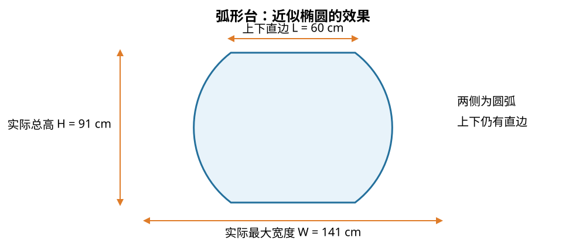

该轮廓仍由上下直边和两侧圆弧组成，并非数学上的椭圆。是否适用于具体椭圆订单，应对照客户尺寸图和实物模板确认。

**输入和处理：**圆桌输入最大宽度 W 和总高 H；圆桌轮廓是外圆与水平带的交集。弧形台另输入直边 L，当前使用上下、左右对称的短圆弧模型，L 不能仅由 W、H 唯一推断。自动工作流默认宽、高各增加 1 cm 的总尺寸补偿，弧形台 L 不补偿；手工排版填写的是实际输出尺寸。应在界面同时展示订单尺寸、补偿和实际输出尺寸，避免重复补偿。

**预期结果：**匹配同材质、同花型素材，按目标几何映射边框和内容，提供成品预览以及 JPG 白底、PNG 透明背景输出。对无法可靠识别的边框或素材不合适的情况提示人工检查。

**验收重点：**典型截圆、完整圆、弧形台及极端宽高比；输入和输出尺寸、直边及补偿；边框接头、图案方向和文字；草图识别失败、尺寸不一致、找不到合适素材时的提示。非对称或任意曲线不属于当前模型。

#### 弧形台实际输出效果

以下图片由用户提供，展示不同素材在弧形台轮廓中的实际输出；尺寸为文件名中的订单尺寸，不直接作为最终输出尺寸或验收结论。

**安妮森林 · 订单 90 × 150 cm**：展示文字边框沿轮廓排布及中央花纹效果。

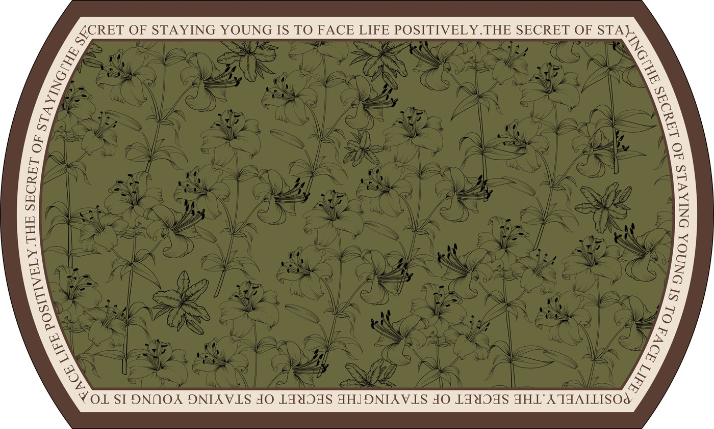

**绿芜花事 · 订单 90 × 140 cm**：展示接近椭圆视觉效果的弧形台及花纹填充。

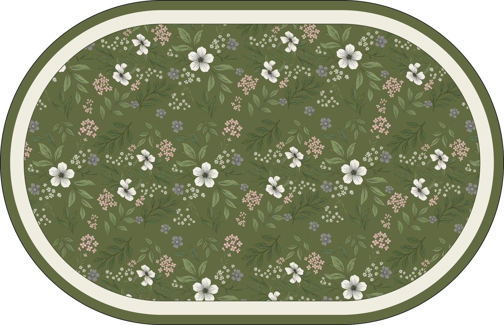

**青芜织序 · 订单 86 × 138 cm**：展示多层边框和纹理背景。

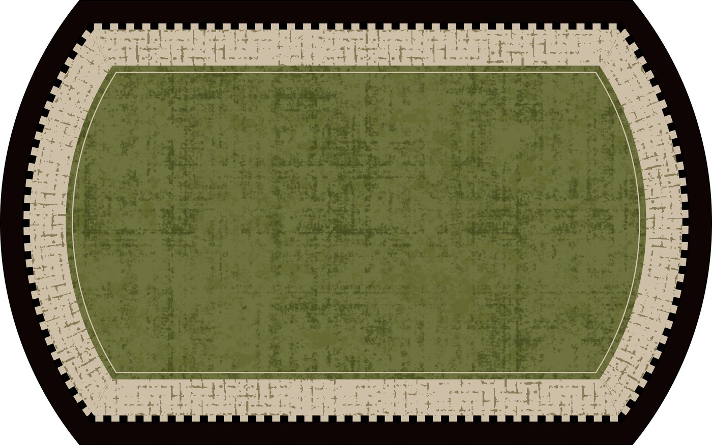

**牡丹织锦 · 订单 84 × 135 cm**：展示圆点装饰边框和花鸟图案。

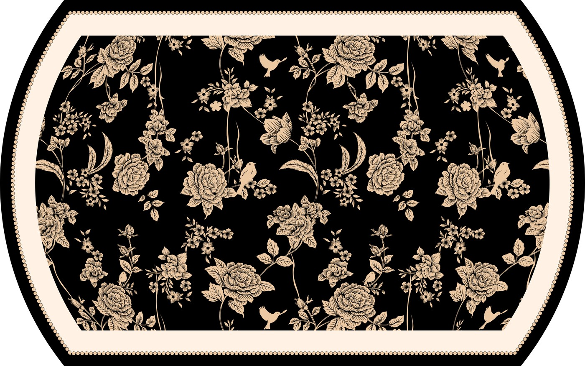

### 5.2 正圆／同心圆

**解决的问题：**为圆形订单建立直径驱动的独立操作流程；当内外区域需要不同素材和环形间隙时，明确同心关系，减少手工叠图和间距计算出错。

**正圆**

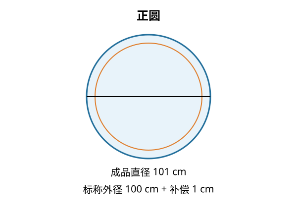

**矩形素材生成正圆**

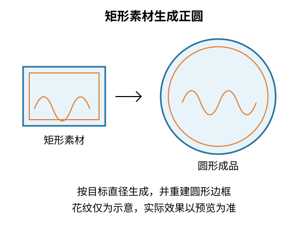

正圆是完整圆形图案，没有内圆或径向间隙。例如标称外径 100 cm、外径补偿 1 cm 时，成品外径为 101 cm。矩形素材可按目标圆形重建边框，具体花纹效果须以实际预览为准。

**同心圆的三种情况：**以下以输入内圆所需直径 55 cm、内圆补偿 1 cm 为例，补偿后的基准直径为 56 cm；间隙均指单边径向距离。

**无间隙**

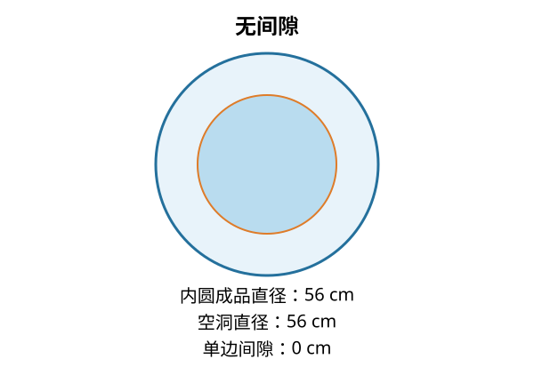

**间隙向外**

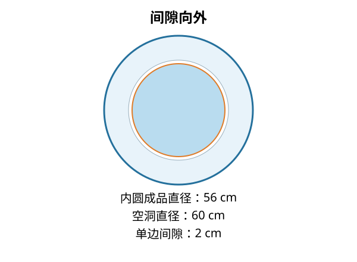

**间隙向内**

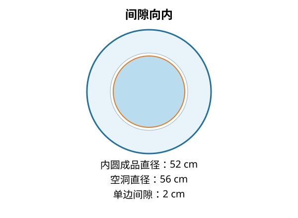

| 情况 | 解决的问题 | 计算关系与示例 |
|---|---|---|
| 无间隙 | 内圆与外环直接贴合，适用于不需要留缝的订单 | 单边间隙为 0；内圆成品直径 56 cm，空洞直径 56 cm。 |
| 间隙向外 | 保持内圆成品直径，在其外侧留出间隙 | 内圆成品直径保持 56 cm；单边间隙 2 cm，空洞直径为 56 + 2 × 2 = 60 cm。 |
| 间隙向内 | 保持外环空洞直径不变，在空洞内侧留出间隙 | 空洞直径保持 56 cm；单边间隙 2 cm，内圆成品直径为 56 − 2 × 2 = 52 cm。 |

其中“空洞直径”指外环内侧边界的直径，包含内圆和两侧间隙；是否作为实际加工开孔仍需按输出用途确认。各情况均须保证内圆成品直径大于零，且空洞直径小于实际外圆直径。

**输入和处理：**输入标称外径、补偿；同心模式增加内圆所需直径和单边径向间隙，可选择间隙计算方向，并可分别指定外圆、内圆素材。当前界面先对内圆所需直径增加 1 cm，再按所选间隙方向计算内圆成品直径；外径补偿另行设置。几何上需要保证内圆与两侧间隙能放入实际外圆；素材可来自圆形素材或由矩形素材重建。

需要特别说明：内圆的 `+1 cm` 补偿目前硬编码在界面计算中，外径补偿则由“直径损耗补偿”参数控制。两者语义是否一致、内圆补偿是否应改为可配置，须由业务方确认后再定稿。当前工作区另有《同心圆内圆花纹比例调整》设计记录，尚未在界面提供比例参数，是否纳入本阶段也需明确。

**预期结果：**正圆按目标直径生成图案；同心圆显示内圆、外圆与间隙，并可输出预览和成品。应明确 PNG 透明区域、JPG 白底以及轮廓线的含义。圆桌模块的既有内圆是填充圆，不应与独立同心圆模块的间隙处理混为一谈，也不能未经验收宣称其满足真实镂空加工要求。

**验收重点：**正圆与同心圆切换；内外素材相同和不同；间隙向内、向外的实际计算；补偿仅应用一次；内径与间隙接近外径的边界；描边、透明度、文件尺寸以及成品与预览一致性。应由业务方确认间隙究竟代表视觉留白、透明区域还是加工开孔，以及是否需要单独输出内圆或切割路径。

#### 正圆与同心圆实际输出效果

以下图片由用户提供，分别展示正圆、有可见间隙的同心圆及内外圆贴合的同心圆。仅凭成品图不能确定间隙采用向内还是向外计算，也不能确认实际生产尺寸。

**蔓生花 · 正圆**：文件名标注直径 67.5 cm，展示完整圆形花纹和圆周装饰边框。

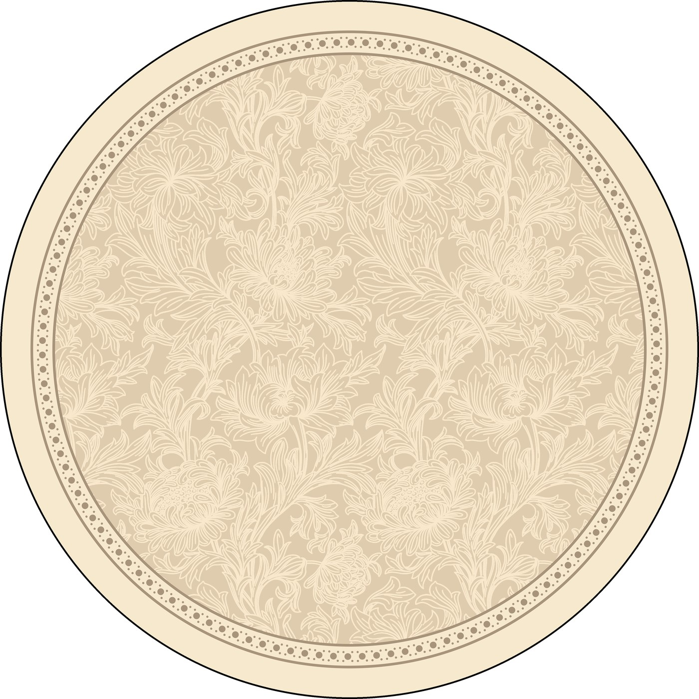

**蔓生花 · 有间隙同心圆**：文件名标注直径 95，图中内圆与外环之间可见白色间隙。

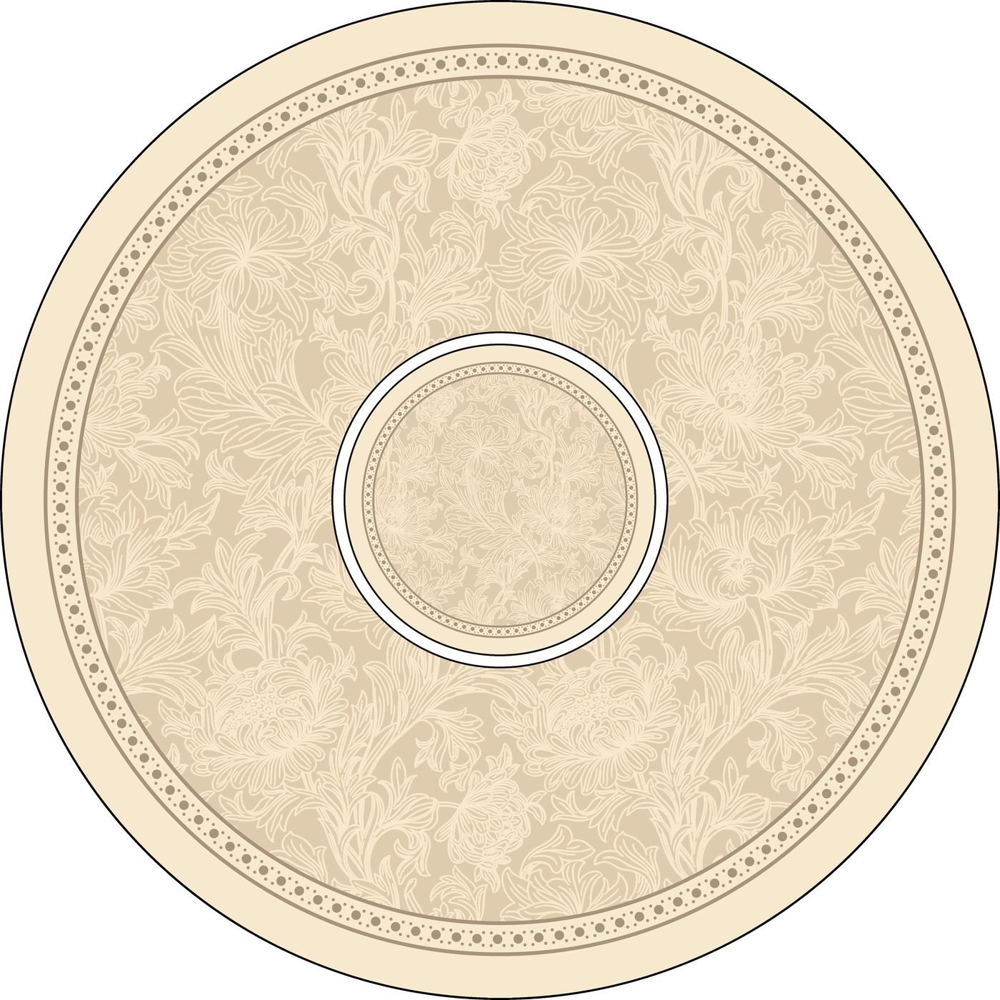

**蔓生花 · 贴合同心圆**：文件名标注直径 105 cm，展示内圆与外环贴合的效果。

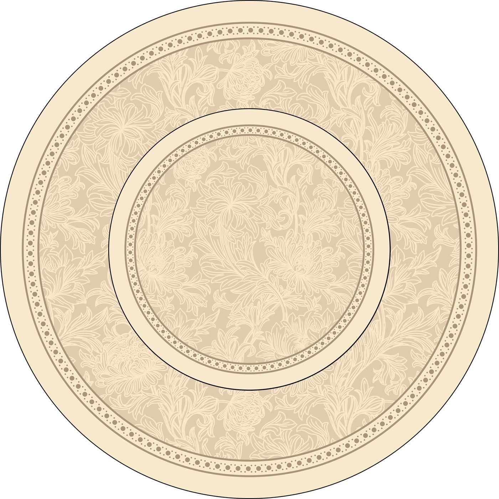

### 5.3 马肚形

**解决的问题：**处理四周有圆角、边缘向外鼓出的对称异形台面。仅凭最大宽高无法唯一确定其形状，需要额外参数描述曲线与圆角位置，降低凭目测绘制造成的误差。

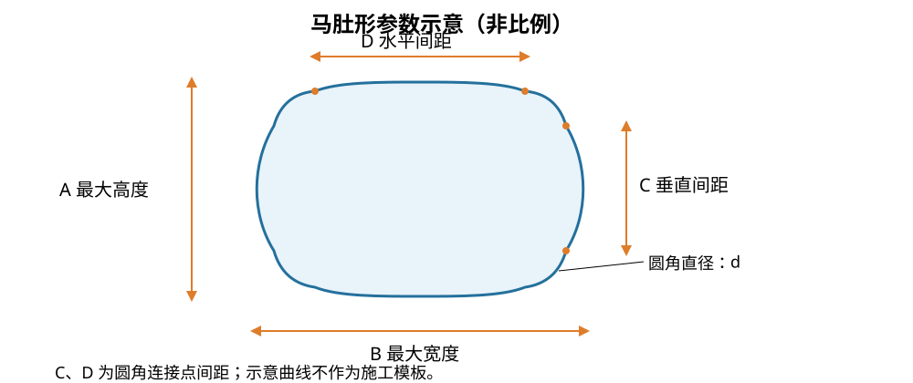

示意仅解释参数关系，不代表实际曲率或施工图。当前几何实现为上下、左右对称：圆角采用圆弧，边缘采用平滑插值；A 是最大高度、B 是最大宽度，C、D 为连接点间距，d 为圆角直径。当前模型要求各值大于零、`C + d ≤ A`、`D + d ≤ B`。自动流程对 A、B 应用总尺寸补偿，C、D 和圆角直径按输入值生成；上传草图目前只供对照，需手工填写尺寸。

除“未完善”外，当前源码还有三项明确限制：不支持同心内圆；只支持普通矩形边框素材，特殊边框或独立图案素材会被拒绝；草图尺寸不自动关联。上述限制应写入用户说明，不能仅靠界面标记传达。

**预期结果：**填写参数后显示轮廓，匹配或指定素材，生成预览并输出图片；操作人员可核对尺寸及实际曲线。

**完善重点：**收集经确认的实物样板和尺寸图，核实连接点定义、圆角、边缘曲率和补偿原则；验证曲线连接平滑、边框不扭曲、复杂花纹不被错误截断；明确不支持的非对称情况。源码还存在可调整 C、D 的参考近似能力，若未来启用，必须明确显示调整后的实际值并获得业务认可，不能把近似结果当作原尺寸。

**验收重点：**普通和极限参数、错误组合提示、对称性、轮廓与真实模板的偏差、预览和导出一致性，以及不同边框和花纹的可接受效果。容差和合格标准须与业务方按实际生产工艺确定。

## 六、共用模块及对应问题

| 模块 | 解决的问题 | 设计与处理方式 | 核对重点 |
|---|---|---|---|
| 订单与尺寸解析 | 重复录入，名称和尺寸易错 | 从文件名提取花型、材质及尺寸，允许人工修正 | 解析失败、单位、输入与草图冲突 |
| 素材图库 | 大图库查找慢，选错素材 | 按业务规则筛选和排序；支持手工指定、索引及刷新 | 无候选、尺寸不足、同名、图库变化 |
| 草图与 OCR | 手绘尺寸转录耗时 | Windows 本地 OCR 识别并展示候选；人工确认；不可靠时手输 | 清晰度、缺项、识别错误；马肚形当前不自动关联 |
| 几何与尺寸 | 同一组尺寸在不同轮廓含义不同 | 各形状使用独立参数及校验；模型以厘米表示 | 极限参数、补偿、轮廓闭合和物理尺寸 |
| 素材结构识别 | 简单裁剪破坏边框及花纹 | 分析内容、边框、装饰条带并按视觉结构处理 | 难识别时警告，避免承诺所有图案均完美适配 |
| 图像映射和渲染 | 平直素材适配弯曲边界时发生断裂或变形 | 内容保持合理比例和方向；边框沿轮廓映射，周期装饰尽量闭合 | 接头、文字、圆点、非周期图案、复杂花纹 |
| 预览与人工调整 | 错误直至打印才发现 | 显示轮廓、尺寸、素材来源和效果；支持调整与重预览 | 展示的参数是否与实际生成一致 |
| 输出与项目保存 | 预览不能直接满足交付 | 根据厘米和 DPI 计算像素；JPG 白底、PNG 透明；手工设计可保存 JSON | 尺寸、透明度、编码、保存失败处理 |
| 后台任务与性能 | 大图处理阻塞操作 | 后台线程、分块计算、缓存、索引与进度反馈 | 取消、内存、网络图库变化和失败恢复 |

现有匹配规则以源码和 README 为准：矩形素材匹配先限定同材质、同花型，候选长短边需满足目标对应尺寸的 80%；文件名含“裁剪有图、圆形、直径、水池、挖角”等标记的素材会被排除；比例差及尺寸接近程度参与排序。若无候选达到 80%，流程直接报错，不自动选择过小素材；若存在合格候选但比例差超过 5%，允许使用兜底并提示人工确认。规则能减少不合适素材，但不能代替人工检查图像清晰度和最终视觉效果。

## 七、设计实现架构

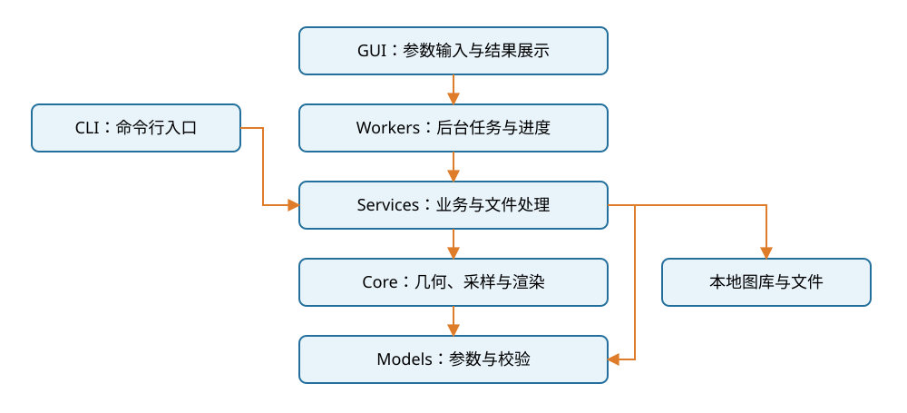

依赖方向遵循项目约束：GUI／CLI 通过服务或后台任务组织业务，核心计算依赖模型；模型和核心计算不依赖 Qt 或文件操作。实际入口可以直接调用服务，无需强制所有 CLI 调用经过线程。

需要明确 CLI 的范围：当前命令行只支持圆桌（`circular`）和弧形台（`arc`），不支持正圆／同心圆与马肚形；这两类形状目前只在桌面界面提供。若业务需要批量或无界面运行，应另列需求，不能根据本架构图推定 CLI 已覆盖全部模块。

| 层 | 主要职责 | 现有位置 |
|---|---|---|
| 表现层 | 选择模块、录入参数、显示轮廓与预览 | `shape_crop/gui/`、`shape_crop/cli.py` |
| 后台任务 | 执行耗时渲染和草图识别，传递状态 | `shape_crop/workers/`，正圆模块也有独立后台线程 |
| 服务层 | 匹配、读取、素材分析、OCR、业务编排、导出 | `shape_crop/services/` |
| 计算层 | 形状几何、轮廓映射、采样和图像合成 | `shape_crop/core/` |
| 模型层 | 不可变设计参数、请求参数与业务约束 | `shape_crop/models/` |

**关键数据关系：**订单与用户参数 → 形状及尺寸参数 → 匹配的素材 → 素材结构分析 → 几何轮廓和图案映射 → 预览或全尺寸输出。模型中使用厘米，输出时按 `像素 ≈ 厘米 ÷ 2.54 × DPI` 换算并取整。预览使用缩图以提高响应速度；导出应使用原分辨率素材。当前全尺寸输出存在 1.8 亿像素限制，且最终画布仍占用内存，性能取决于机器、素材及目录环境。

技术栈为 Python 3.13、PyQt5、NumPy、Pillow、pytest。维持现有分层；新增或升级依赖、修改依赖方向和修改 `models/design.py` 全局校验逻辑需按项目规则事先取得批准。

## 八、实施阶段与交付物

阶段为建议顺序，工作量和日期须在真实样本、人员投入及验收范围明确后估算，不在缺乏依据时承诺工期。

| 阶段 | 工作内容 | 交付物与完成条件 |
|---|---|---|
| 1. 业务确认与样本整理 | 收集三类订单、草图、原素材、期望成品和生产规则；确认关键术语及误差容许值 | 样本清单、尺寸及补偿规则、已确认的验收口径 |
| 2. 当前能力核验 | 根据现有界面和代码逐模块运行，记录可复现问题及文档偏差 | 功能现状表、问题清单、修订的用户说明 |
| 3. 圆桌／弧形台稳固 | 核验匹配、草图、几何、复杂花纹和导出；修复确认的问题 | 可复现回归样本与验证记录 |
| 4. 正圆／同心圆完善 | 确认内外圆、间隙和补偿语义，完善提示并验证实际输出 | 操作说明、内外素材及间隙验收结果 |
| 5. 马肚形完善 | 与样板对照确认几何模型、尺寸定义、曲线及映射；处理边界情况 | 通过确认的参数示意、样板对比与验收结论 |
| 6. 全流程与发布准备 | 检查跨模块一致性、错误恢复、大图表现和打包运行 | 测试报告、用户手册、版本说明及可交付程序 |

建议优先保证已有流程可靠，再完善需要业务定义的同心圆和马肚形。各阶段可按样本准备情况调整，不以“有入口”作为完成标准。

## 九、质量与验收计划

1. **功能验证：**逐模块执行输入、匹配、预览、修改、导出及失败恢复；覆盖手动素材、无候选和错误文件。
2. **几何验证：**核对尺寸、对称性、边界闭合、补偿计算及非法参数；马肚形与经确认的模板进行尺寸和轮廓比较。
3. **视觉验证：**使用真实的满铺、花卉、文字、圆点、周期与非周期边框素材，比较原图及成品的花纹方向、层次、接头和细线。建立经业务确认的对照样本，避免仅凭单一图片判断。
4. **输出验证：**读取导出文件检查像素、DPI 元数据、格式及透明度；按指定工艺打印或试制核对实际尺寸。DPI 元数据正确不等于所有打印软件都会按预期缩放。
5. **性能与稳定性：**在实际图库、设备及大图尺寸下记录匹配、预览、导出时间和资源占用，验证失败、取消与重复订单；用测量结果确定目标。
6. **自动化回归：**运行 `python -m pytest tests -q`，针对修改补充有业务意义的用例；用 `python benchmarks/performance.py` 等现有基准复测。视觉效果仍需要人工验收。

## 十、风险与待确认事项

| 事项 | 影响 | 建议处理 |
|---|---|---|
| 马肚形实物轮廓是否符合当前平滑插值模型 | 尺寸相同仍可能形状不同 | 采集标注完整的样板，确认轮廓与容差 |
| 同心圆间隙和开孔的业务含义 | 图片留白可能不能直接作为加工镂空 | 确认透明、白底、独立图层或切割路径需求 |
| 补偿和圆角工艺 | 单位或补偿位置错误影响成品 | 对每种形状明确标称尺寸、实际尺寸与补偿应用次数 |
| OCR 和复杂花纹识别并非总可靠 | 错误识别会影响订单 | 保留人工确认、手工指定及清楚的失败提示 |
| 素材尺寸、版权与色彩 | 分辨率或打印色彩可能不满足交付 | 核对素材来源和原图质量，并在目标设备上试印 |
| 本地内存和共享图库 | 大图或网络环境造成耗时和失败 | 用实际环境测试，展示限制和可操作的错误信息 |
| 文档与源码版本不同步 | 用户按旧说明误判能力 | 发布前同步 README、使用手册及版本说明 |

## 十一、建议的项目完成标准

三类形状的尺寸语义经业务确认；代表性真实订单从输入到导出可重复完成；关键边界和异常有清晰提示；预览与成品参数一致；自动测试与真实素材视觉验收通过；用户手册与实际版本一致。对暂不支持或存在视觉局限的情形，应明确告知并保留人工处理路径。

## 十二、项目组织、职责与变更控制

| 角色 | 主要职责 | 必须确认的事项 |
|---|---|---|
| 业务负责人 | 提供订单、样板、工艺规则和验收口径 | 尺寸语义、间隙含义、容差、优先级和可接受范围 |
| 需求／产品 | 维护需求范围、样本清单和文档 | 功能与非目标、验收标准、版本说明 |
| 开发 | 实现、测试、构建和问题修复 | 技术方案、构建基线、发布包和已知限制 |
| 验收／测试 | 复现、回归、视觉对照和签字 | 样本通过结论、遗留问题是否接受 |
| 发布／运维 | 构建、分发、回滚和用户支持 | 发布清单、校验值、升级方式和反馈闭环 |

每个阶段至少应明确负责人、进入条件、交付物和退出条件。项目规则中已规定：新增或升级依赖、修改架构分层依赖方向、修改 `models/design.py` 全局校验逻辑、删除测试文件或验证素材，须事先批准。业务规则变更（补偿次数、间隙语义、匹配门槛）还必须同步修改代码、测试、样本和文档，不能只改其中一项。

## 十三、版本、构建与发布管理

当前版本状态需要先纠正：源码与 README 为 1.0.3，CHANGELOG 最新记录为 0.4.3；同一个 0.4.3 存在不同日期的多次构建；多处修复只进入源码，未重新打包进分发的 EXE。仅凭文件名无法判断用户运行的是哪个构建，这是交付风险，不是普通文档问题。

建议规则：

| 对象 | 规则 |
|---|---|
| 源码版本 | 与程序内版本号、README、用户手册、CHANGELOG 保持一致 |
| 构建版本 | 每次发布生成唯一构建号；同一版本号不得对应多个不同二进制 |
| 文档版本 | 发布说明必须对应具体源码提交和构建产物 |
| 热修复 | 修复进入源码后必须重新构建、复测并生成新的构建记录 |

每个发布包至少包含：源码提交号、依赖版本、EXE、版本说明、用户手册、SHA-256 校验值、回归测试结果和已知问题清单。

**发布检查清单：**

- 全量测试通过，视觉对比样本完成；
- 版本号在源码、界面、文档和文件名中一致；
- 已知问题逐项确认，明确“接受、修复或移出范围”；
- 在干净机器或干净用户目录启动，确认不依赖开发环境；
- 验证本地图库、共享图库、无网络、长路径和中文路径；
- 记录 SHA-256，保留上一版安装包和回滚说明；
- 发布后收集首轮用户反馈，确认无集中性故障。

当前采用整包替换方式，没有自动更新机制。升级前应保留上一版程序并备份用户配置；回滚时必须确认旧版本能读取当前配置和项目文件。

## 十四、已知问题与遗留缺陷

以下问题来自 CHANGELOG 和当前源码核对，发布前应逐项关闭或明确接受：

| 编号 | 类别 | 问题 | 影响 | 当前处理 | 退出条件 |
|---|---|---|---|---|---|
| K-01 | 圆桌／弧形台 | 岁月珐琅 30×120cm、80×140cm 内框问题记录为未修复 | 特定订单边框效果不达标 | 源码保留，需复现 | 修复并有对比样本，或业务确认移出支持范围 |
| K-02 | 圆桌／弧形台 | 闲叙邂逅 45×310cm 完整背景周期未验证 | 长尺寸订单可能出现周期错位 | 待验证 | 完成整单验证并留存对照图 |
| K-03 | 发布 | 多次修复只更新源码，未重新打包 EXE | 用户运行的版本与文档不一致 | 需重建发布包 | 发布包包含全部已确认修复，并有构建记录 |
| K-04 | 文档 | README、用户手册仍把正圆／同心圆写成待开发 | 用户误判软件能力，培训口径不一致 | 需同步文档 | 文档与当前界面一致并经确认 |
| K-05 | 马肚形 | 模块标记“未完善”，缺少真实样板验证 | 不能作为生产承诺 | 限制在界面内提示 | 样板、尺寸定义和输出验收通过 |
| K-06 | 同心圆 | 内圆花纹比例调整只有设计记录，界面尚无比例参数 | 内圆素材可能需要手工处理 | 待业务确认 | 明确纳入或移出本阶段 |
| K-07 | 图库 | 命名规则、花型别名和素材准入未形成集中规范 | 匹配结果依赖个人经验 | 需整理规范 | 发布命名规范和素材验收表 |

## 十五、非功能需求与兼容性

| 项目 | 当前情况 | 发布前需确认 |
|---|---|---|
| 操作系统 | 开发、打包和使用均在 Windows 环境 | 明确支持的 Windows 版本和位数 |
| 运行环境 | Python 3.13、PyQt5 5.15、NumPy、Pillow；发布为 EXE | 目标机器是否需要安装运行库 |
| 图库素材格式 | 圆桌／弧形台当前只接受 JPG／JPEG；正圆／同心圆可接受 PNG | 是否统一格式，是否允许其他格式 |
| 草图格式 | PNG、JPG、BMP、TIFF 等常见图片 | 最大文件、最小清晰度和 OCR 语言包要求 |
| 输出格式 | JPG 白底、PNG 透明，写入 DPI 元数据 | JPG 质量、透明区域和描边规则 |
| 输出上限 | 全尺寸输出约 1.8 亿像素；预览最长边约 1200px | 超出上限时的提示和降级方案 |
| 图库规模 | 支持本地目录和共享目录；索引规模影响首次扫描时间 | 最大图库规模、网络延迟和权限要求 |
| 网络与隐私 | 业务处理在本地完成；草图 OCR 使用 Windows 本地能力 | 是否存在任何上传或外部服务 |
| 性能 | 见 `docs/PERFORMANCE.md` 的历史测量记录 | 在目标机器和真实图库上建立发布基线 |
| 硬件 | 当前无正式最低配置 | 明确内存、磁盘和屏幕分辨率要求 |

**建议的验收目标（需业务确认后锁定）：**

- 典型订单预览在目标机器上可交互，参数修改后无需长时间等待；
- 全尺寸导出时间不超过业务可接受上限，且内存不导致崩溃；
- 输出尺寸与目标尺寸的误差在约定范围内，补偿只应用一次；
- 预览和成品使用同一组参数，不出现“预览正确、导出错误”；
- 在干净环境启动、打开图库、匹配、预览、导出全流程可完成；
- 失败、取消和重复操作不会留下损坏文件或错误状态。

**待业务确认的参数清单：**内圆 `+1 cm` 补偿是否保留及是否可配置；间隙代表视觉留白、透明区域还是加工开孔；各形状的尺寸容差；马肚形 C、D 和圆角的定义；JPG 质量与描边宽度；输出文件命名和覆盖策略；是否需要批量处理和多订单并发。

## 十六、合规、授权与数据边界

| 事项 | 风险 | 发布前动作 |
|---|---|---|
| 软件授权 | 项目使用 PyQt5；PyQt5 采用 GPL 或商业授权，仓库当前没有 LICENSE | 明确软件分发方式和授权路径，必要时取得商业授权 |
| 第三方依赖 | NumPy、Pillow 等各有许可证 | 汇总依赖清单和许可证，随发布包留存 |
| 客户素材 | 素材可能来自客户或第三方图库 | 确认使用、修改和交付授权，保留来源记录 |
| 文档示例 | 本计划书和说明中包含用户提供的成品图与素材截图 | 对外分发前确认示例图的使用许可，必要时脱敏或替换 |
| 订单数据 | 订单名、尺寸、客户名称可能出现在截图、日志和文件名中 | 对外材料脱敏；本地日志和临时文件定期清理 |
| OCR 与网络 | 草图识别使用本地能力，但仍需确认不会上传 | 在说明中明确数据不离开本机；共享图库除外 |
| 输出留存 | 成品图可能包含客户图案 | 明确保存期限、访问权限和清理责任 |

上述事项不应只作为“风险提示”留在计划中，应作为发布前置条件，由业务和法务确认后再对外分发。

## 十七、运营支持与故障排查

**用户反馈应至少包含：**程序版本和构建号、订单名称与尺寸、使用的图库路径、素材文件名、操作步骤、截图、是否可重复，以及导出文件或错误提示。缺少这些信息时，仅凭“效果不对”很难定位。

建议建立以下支持机制：

- 在程序内提供“复制诊断信息”或等价入口，包含版本、系统、关键参数和最近错误；
- 明确问题分级：无法启动、无法导出、尺寸错误、视觉不符、使用咨询；
- 对无法启动、杀毒软件拦截、SmartScreen 提示提供处理说明；
- 升级前发布版本说明和已知问题，升级后收集首轮反馈；
- 对已确认的视觉问题保留原素材、参数和成品，形成可复现样本；
- 培训内容以当前版本界面为准，不使用过期截图和旧版手册。

当前没有自动更新和远程诊断机制。若用户分散或无法提供日志，应优先补充可导出的诊断信息，而不是仅依赖口头描述。

## 十八、交付物与文档同步

| 交付物 | 内容 | 责任人 | 更新时机 |
|---|---|---|---|
| 源码与构建 | 源码提交、依赖版本、可运行程序 | 开发 | 每次发布 |
| 发布包 | EXE、版本说明、SHA-256、已知问题 | 发布 | 每次发布 |
| 用户手册 | 三类形状操作、限制、错误处理 | 需求／开发 | 功能或界面变化时 |
| README | 快速开始、命令、格式和限制 | 开发 | 每次发布 |
| CHANGELOG | 按版本记录新增、修复和已知问题 | 开发 | 每次发布 |
| 计划书 | 范围、现状、验收和风险 | 需求／产品 | 范围或基线变化时 |
| 样本库 | 原材料、参数、期望成品、对照结论 | 业务／测试 | 新增样本或规则变化时 |
| 设计记录 | 几何、算法和交互设计 | 开发 | 方案变更时 |

**文档同步要求：**同一事实只保留一个权威来源；README 负责快速开始和限制，用户手册负责操作步骤，CHANGELOG 负责版本差异，计划书负责范围和验收。发布前逐项检查模块状态、版本号、命令、截图和限制说明，避免再次出现“源码已实现、文档仍写待开发”。

## 十九、需求追踪与量化验收

| 需求 | 模块 | 验证入口 | 验收样本 | 通过标准 |
|---|---|---|---|---|
| 订单名称和尺寸可解析、可人工修正 | 解析／界面 | `tests/test_workflow.py` 等 | 常见命名、异常命名、中文路径 | 解析结果可见，冲突有提示 |
| 素材匹配符合业务规则 | 图库／匹配 | `tests/test_catalog_matching.py` | 同花型、多候选、无候选、过小素材 | 不选过小素材，提示可理解 |
| 圆桌／弧形台尺寸和补偿正确 | 几何／渲染 | `tests/test_arc.py`、`tests/test_geometry.py` | 典型、完整圆、极端宽高比 | 尺寸、直边和补偿只应用一次 |
| 正圆／同心圆内外关系正确 | 圆形模块 | `tests/test_circle_module.py` | 正圆、无间隙、向外、向内、边界 | 内外径和间隙符合定义 |
| 马肚形轮廓与样板一致 | 马肚形 | `tests/test_belly_geometry.py`、`tests/test_belly_render.py` | 经确认的实物样板 | 轮廓偏差在约定范围内 |
| 预览与导出一致 | 预览／导出 | `tests/test_pipeline.py` 等 | 同一参数下预览和成品 | 参数一致，无明显结构差异 |
| 失败和异常可恢复 | 全流程 | `tests/test_workflow.py` 等 | 缺素材、错误文件、权限不足 | 有明确提示，不产生损坏文件 |
| 大图性能可接受 | 性能 | `benchmarks/performance.py` | 目标尺寸和真实图库 | 达到发布基线，无崩溃 |

**验收签字建议：**业务负责人确认尺寸和视觉口径；测试确认样本通过；开发确认版本和构建可追溯；发布确认分发包和校验值。未通过的项必须记录为遗留问题，不能用“已知”“后续优化”代替结论。

## 附录 A　术语表

| 术语 | 含义 |
|---|---|
| 标称尺寸 | 订单或文件名中的目标尺寸，未计补偿 |
| 实际输出尺寸 | 标称尺寸加补偿后用于渲染和导出的尺寸 |
| 总尺寸补偿 | 自动流程对宽度、高度各增加的量；直边不补偿 |
| 空洞直径 | 同心圆外环内侧边界直径，包含内圆和两侧间隙 |
| 单边径向间隙 | 内圆与外环之间单侧的距离 |
| 直边 | 弧形台上下两条直线段的长度 |
| 内缩 | 素材边框或内容向轮廓内部收进的处理 |
| 识别尺度 | 素材分析时使用的相对尺寸，不等同输出像素 |
| 兜底素材 | 比例不完全匹配但仍被选用的候选，需要人工确认 |
| 稳定样本 | 已确认原材料、参数和期望结果的可复现样本 |

## 附录 B　测试与样本清单

自动化测试位于 `tests/`，当前包含 50 多个测试文件，覆盖几何、轮廓、图库匹配、工作流、布局回归、视觉结构和性能等。计划书不再只引用少数单文件，发布时应以完整测试目录和实际运行结果为准。

样本清单至少应覆盖：圆桌、完整圆、弧形台、正圆、无间隙同心圆、向外间隙、向内间隙、马肚形；满铺、花卉、文字、圆点、周期边框、非周期边框、多层边框；正常尺寸、极端宽高比、接近上限尺寸；正常文件、损坏文件、权限不足、共享图库断开。

## 参考依据

- `README.md`：订单、匹配、渲染、补偿和现有限制。
- `docs/用户使用说明.md`：既有操作流程；其中部分模块状态已落后于源码。
- `docs/ARCHITECTURE.md`、`docs/PERFORMANCE.md`：分层约束和性能测量记录。
- `CHANGELOG.md`、`docs/更新说明_1.0.3.md`：版本历史、已修复项和遗留问题。
- `项目文档/` 下的三份源码解读、项目分析报告和实际输出示例：业务规则与历史问题背景。
- `shape_crop/gui/main_window.py`、`shape_crop/gui/circle_module.py`：当前模块入口、参数和交互。
- `shape_crop/services/workflow.py`、`shape_crop/services/catalog.py`、`shape_crop/services/circle.py`：业务编排、素材匹配和圆形生成规则。
- `shape_crop/core/belly_geometry.py`、`shape_crop/core/belly_renderer.py`：马肚形几何、限制和渲染。
- `shape_crop/cli.py`：命令行仅支持圆桌和弧形台。
- `docs/superpowers/specs/`、`docs/superpowers/plans/`：正圆、同心圆内圆比例等设计记录。
- `tests/` 与 `benchmarks/`：完整测试目录和性能基准；本文编写时未重新运行全量测试，测试文件存在不等于测试当前通过。界面截图由当前源码离屏渲染生成，成品预览来自 `实际输出示例`，仅作界面示意。
